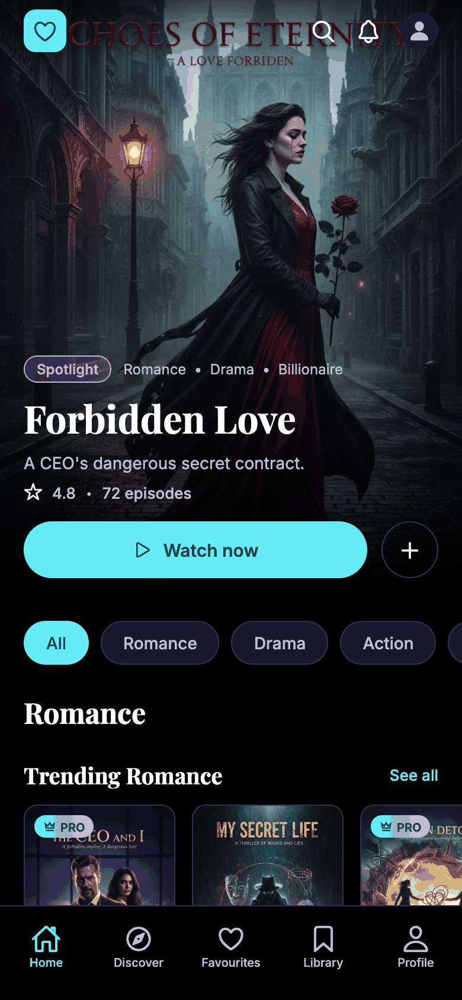
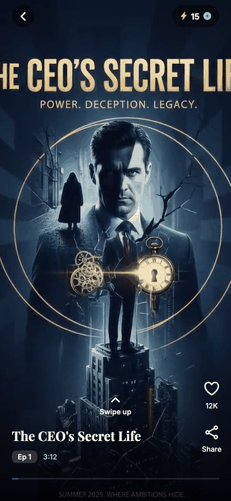
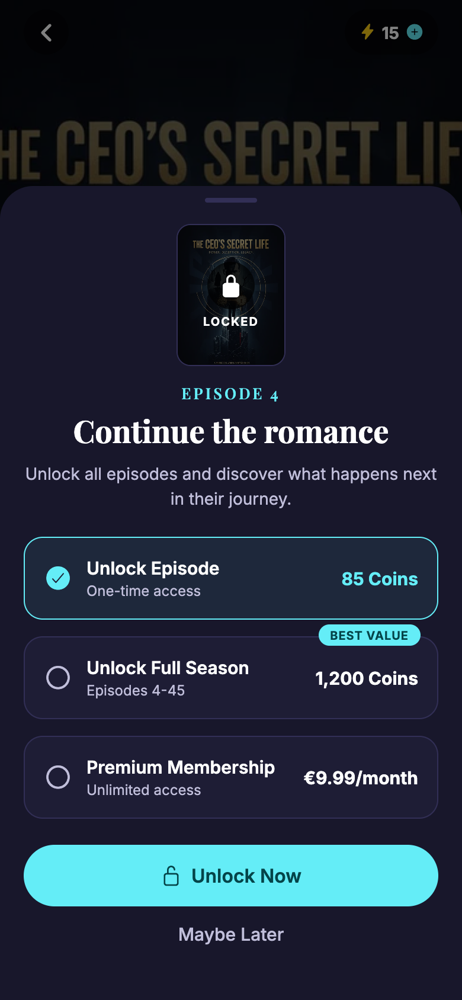
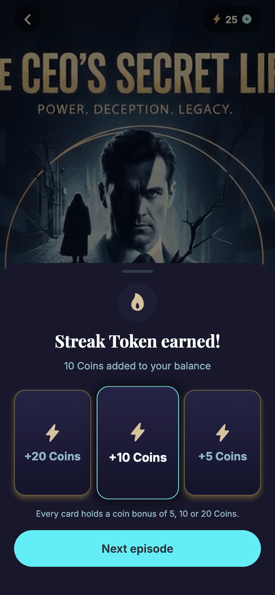

# DramaFlash mock-up

A clickable mock-up of a short-drama streaming app, built for the TargetVideo (DramaFlash) Mobile App Developer interview, Option A, from the supplied screen design. It has the home feed, a vertical player that locks after the cliffhanger, and a full unlock flow paid with coins. On top of that I built a small gamification feature, the **Streak Token reward flip** (see below).

- **Web:** <WEB LINK> (best on a phone; on a desktop the app stays a centred phone-width column)
- **Phone:** Expo Go on SDK 57, see "Run it"

Everything is mocked: there is no backend, no real payment and no real video. More screenshots are in [`docs/screenshots`](docs/screenshots/INDEX.md).

| Home | Player | Unlock sheet | Reward flip |
|---|---|---|---|
|  |  |  |  |

## What is covered

| Brief | Where |
|---|---|
| Home feed | Home: hero, genre chips that filter, rails, "See all" screens |
| Player with the lock after the cliffhanger | Vertical player: episodes 1 to 3 free, episode 4 locked |
| One unlock flow | Coins: unlock sheet, a recharge step when coins are short, a confirmation, a mocked purchase, the episode plays |

Also built: series detail, Favourites, Discover (search and genre browse), Library (what you unlocked and the coin history), a Profile with the coin balance, one Premium Membership (subscribe, cancel, resubscribe), the language switch and a "Reset demo data" button. English and German. Coins, unlocks, membership and favourites are saved on the device. Anything that spends coins or money asks first in a bottom sheet.

## Try it (2 minutes)

A recording of the whole flow: [`unlock-flow.gif`](docs/screenshots/unlock-flow.gif). The reward flip: [`reward-flip.gif`](docs/screenshots/reward-flip.gif).

1. Open "The CEO's Secret Life" (it has the design's named episodes and cast) and tap **Play Ep 1**. Swipe up for the next episode.
2. **Reach the lock fast:** tap a locked episode (4 or later) in the episode list on the series page, or drag the thin progress bar to the far right on episodes 1 to 3. (The placeholder clips loop for the listed length, about 3 minutes each, so watching 1 to 3 in full takes about 9 minutes.)
3. Tap the lock card, then **Unlock Now**. You start with 15 coins, so the sheet moves to the recharge step: buy a pack, confirm, and the episode plays.
4. **Reward flip:** on episode 1 or 2, let it play about 20 seconds, then drag the bar to the end. Flip a gold card.
5. Profile, **Reset demo data**, to start over.

## Gamification: the Streak Token reward flip

**What.** When a free episode before the cliffhanger ends and was really watched, a sheet shows three face-down gold cards. One flip pays a coin bonus of 5, 10 or 20, and closing the sheet moves on to the next episode.

**Why.** Part of this round was about keeping viewers watching. A coin paywall only earns money if people reach it, so the reward targets the moment before it: a reason to finish an episode, a pause that leads into the next one, and free coins that make a first top-up feel closer. It reuses what the unlock flow already had (wallet, transaction log, sheets, saved data).

**The logic.** `EpisodeVideo` counts seconds that really played (seeks and bar drags add nothing). When the episode ends, `offerRewardIfEarned` (`src/store/rewardsSlice.ts`) offers a reward only if the episode is one of the first two free ones, the real watch time reaches 80% (`src/data/rewards.ts`), and it has not paid out before. The bonuses are shuffled when the offer is made, `claimReward` credits the wallet and logs it, and the claim is saved.

**Guardrails.**
- Real watching, not the bar's position: a seekable bar makes "reached 80%" trivial to fake.
- Never after the last free episode, which leads into the paywall.
- No losing card, odds printed, tokens cannot be bought (keeps clear of loot-box rules).
- Small amounts: two rewards plus the starting 15 coins stay short of an 85 coin episode, so recharge is still needed.
- One reward per episode, no countdown (it would race the auto-advance), and the sheet is skippable.

**Demo shortcut.** 80% of 3 minutes is too long to demo, so the requirement is capped at 20 real seconds (`DEMO_MAX_WATCH_SECONDS`).

**Measuring it.** Episodes per session and day-1 / day-7 retention; reveal rate and next-episode starts; coin purchase conversion. Guardrail: lock-to-purchase at episode 4 must not fall. A/B per user for about two weeks: no reward, the flip, the flip with another bonus size.

## Run it

```bash
npm install
npx expo start      # press w for web, or scan the QR code with the store version of Expo Go
npm test            # Jest: 60 tests on the store and data logic
npx tsc --noEmit    # run `npx expo start` once first (typed routes are generated)
npx expo lint
```

The project is on Expo SDK 57 because that is what the store version of Expo Go supports (an SDK 58 project was refused by it). The web version is deployed to GitHub Pages by `.github/workflows/deploy.yml` on every push to `main`, after the type check and tests.

## How it is built

Expo, TypeScript (strict), expo-router, Redux Toolkit, `@gorhom/bottom-sheet` with Reanimated and Gesture Handler, expo-video, i18next.

- `src/app` routes only; `src/components` small one-job components; `src/store` slices and thunks; `src/data` mock catalogue, prices and rules; `src/i18n` EN and DE.
- **One place decides what is locked:** `isEpisodeLocked` in `src/store/unlocksSlice.ts`. Components never work it out themselves.
- **Money logic in thunks:** `unlockSelected` and `buyPackAndUnlock` return `unlocked` or `not-enough-coins` (a normal result, not an error). The wallet reacts to a successful unlock and deducts the coins, so money and unlocks cannot drift apart.
- **One unlock sheet with three steps** (choose, recharge, confirm) that swap inside it. Sheets open from a request counter in the store, not an "is open" flag, so the store cannot disagree with the real sheet after a swipe-down.
- Episodes last their listed length: the 10 second clip loops, and the progress bar and end-of-episode event use the listed duration.

## Decisions and mocked vs production

The key choices: coins as the unlock flow (it shows the interesting states: short balance, top-up, unlock); Expo so reviewers can open it in seconds; one price list and one membership where the design contradicts itself (85 coins per episode, 1200 per season, one Premium at EUR 9.99 per month, euros only); tests on the logic only, since the risk is in the rules about money and access.

In production: StoreKit and Play Billing with server-side receipt validation, a server-owned wallet and entitlements, store-owned subscriptions, HLS streaming instead of bundled looped clips, analytics on the funnel. The full table, the list of design inconsistencies and how each was resolved, and a real Android bug story are in [`docs/DECISIONS.md`](docs/DECISIONS.md).

## Known limitations

- The clips are generated placeholders (10 second, silent, a slight zoom over each series' artwork) and loop.
- All data is local to the device: no account, server or real payment.
- Only The CEO's Secret Life has the design's named episodes and a cast; Discover and Library are deliberately simple.
- German was checked by an AI reviewer prompted as a native speaker, not by a person.
- Tested on web in Chrome, on an Android emulator, and on an Android phone and an iPhone in Expo Go. The reward flip and confirmation sheets came last and had the least phone testing.

## What I would do next

- Real billing and a server-owned wallet, with watch time counted on the server.
- Streaming with HLS, preloading and sound.
- More of the reward idea: a streak across episodes, other reward types, A/B tests.
- An ad-unlock option as a third path; an accessibility pass.
- The stable native tabs in SDK 58 for the iOS 26 glass tab bar.
